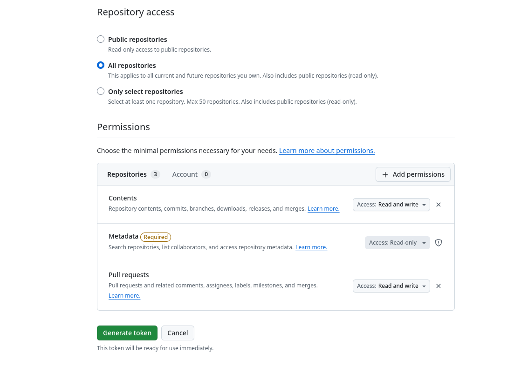

# Drupal Update

The updater is licensed under [MIT](LICENSE). Earlier GPL releases retain their
original license. Third-party dependencies retain their licenses; see
[third-party notices](THIRD_PARTY_NOTICES.md). The supplied project fixtures are
excluded from this relicensing and retain their existing licensing declarations
and third-party notices.

Go CLI port of [valicm/drupal-update](https://github.com/valicm/drupal-update).
Requires composer.json and composer.lock in the working directory, plus a working Composer launcher. The default uses host Composer; a container launcher can provide PHP and Composer.

## Standalone use outside GitHub Actions

Download a binary from [GitHub Releases](https://github.com/valicm/drupal-update/releases). Release archives contain the executable, this guide, the MIT license, and third-party notices. Go is not required to run a downloaded binary; PHP and Composer 2.7+ must be available locally or through your configured launcher.

Available binaries:

| Platform | Architectures | Archive |
| --- | --- | --- |
| Linux | amd64, arm64 | `.tar.gz` |
| macOS (`darwin`) | amd64 (Intel), arm64 (Apple Silicon) | `.tar.gz` |
| Windows | amd64, arm64 | `.zip` |

Linux/macOS installation (select a published Go release; v4 has no Go binaries):

```sh
version=v5.0.0
case "$(uname -s)" in
  Linux) os=linux ;;
  Darwin) os=darwin ;;
  *) echo "Use the Windows ZIP instructions below"; exit 1 ;;
esac
case "$(uname -m)" in
  x86_64) arch=amd64 ;;
  aarch64|arm64) arch=arm64 ;;
  *) echo "Unsupported architecture"; exit 1 ;;
esac
archive="drupal-update_${version}_${os}_${arch}.tar.gz"
release_url="https://github.com/valicm/drupal-update/releases/download/${version}"
mkdir -p "$HOME/.local/bin" "$HOME/.local/share/drupal-update/${version}"
workdir=$(mktemp -d)
curl -fL "${release_url}/${archive}" -o "${workdir}/${archive}"
curl -fL "${release_url}/SHA256SUMS" -o "${workdir}/SHA256SUMS"
(
  cd "$workdir" || exit 1
  awk -v name="$archive" '$2 == name' SHA256SUMS > selected-checksum
  test -s selected-checksum || exit 1
  if command -v sha256sum >/dev/null 2>&1; then
    sha256sum --check selected-checksum || exit 1
  else
    shasum -a 256 --check selected-checksum || exit 1
  fi
  tar -xzf "$archive"
) && cp "$workdir/drupal-update" "$HOME/.local/bin/drupal-update" \
  && cp "$workdir/LICENSE" "$workdir/THIRD_PARTY_NOTICES.md" "$workdir/README.md" \
    "$HOME/.local/share/drupal-update/${version}/"
export PATH="$HOME/.local/bin:$PATH"
drupal-update --version
```

Add `$HOME/.local/bin` to your shell's PATH permanently if needed. The downloaded files remain in the printed/assigned `workdir` for inspection.

On Windows, download the matching ZIP and `SHA256SUMS`, compare the ZIP's SHA-256 with `Get-FileHash`, then use `Expand-Archive` and add the extracted directory to PATH. Keep its license and notice files with the executable. Invoke `drupal-update.exe` from your Drupal project directory.

Run from the directory containing composer.json and composer.lock:

```sh
cd /path/to/drupal-project
drupal-update -t security -o security-updates.md
drupal-update -t minor --scope contrib
drupal-update -t minor --scope core
drupal-update --composer-command 'ddev composer' -t minor
drupal-update -c false -e token,drupal/redirect -o updates.md
```

For other CI systems, install the binary and Composer, then run the same commands in the checked-out Drupal project. There is no GitHub dependency at runtime. Markdown goes to stdout and an optional `-o` file; errors return a nonzero exit code. Set `GITHUB_ACTIONS` only when GitHub's summary/environment files are available.

To build from source, install Go 1.21+ and run `go build -o drupal-update .` (use `-buildvcs=false` in a source directory without usable Git metadata). A source build reports version `dev`; release builds embed their full tag.

The default `semver-safe-update` uses Composer's classification and preserves existing constraints. `all` also changes constraints for packages Composer reports as `update-possible`. Core packages are updated together after contributed packages. Existing development requirements remain development requirements. The legacy `all` mode cannot coordinate core-dev in require-dev; use `major` for coordinated core changes.

Composer can update transitive dependencies with `--with-all-dependencies`. Proposed versions in the summary are discovery results, not confirmation of the installed version. Platform requirements remain enforced. Failed package updates produce a nonzero exit code after writing the report; Composer scripts and plugins can modify the project, so use a working branch and review the resulting diff.

The composite action builds the same CLI and runs it in the caller's workspace. It accepts `update_type`, `update_core`, `update_exclude`, `composer_command`, `update_scope`, and `update_packages`, writes the step summary, and exports `DRUPAL_UPDATES_TABLE`. The selected Composer launcher must already be available and its container or runtime must be ready. CLI flags override action input environment variables.

## Legacy Bash compatibility

The `drupal-update.sh` wrapper forwards every argument unchanged, including the old `-t`, `-c`, `-e`, and `-o` flags and new Go CLI flags. It preserves the caller's project directory, stdout/stderr, exit status, and GitHub input environment variables.

```sh
bash drupal-update.sh -t all -c false -e token,redirect -o summary.md
```

The wrapper tries, in order: `DRUPAL_UPDATE_BINARY`, a binary beside the script, `drupal-update` on PATH, a local source build when Go is installed, then a verified GitHub release download. A source build runs in the script's checkout; upgrades still run in the caller's Drupal project. A downloaded binary is temporary and removed after the command finishes.

The repository wrapper defaults to the latest **stable** full release. To pin v5.0.0 explicitly:

```sh
DRUPAL_UPDATE_VERSION=v5.0.0 bash drupal-update.sh -t minor
curl -fsSL https://raw.githubusercontent.com/valicm/drupal-update/v5.0.0/drupal-update.sh | \
  DRUPAL_UPDATE_VERSION=v5.0.0 bash -s -- -t minor -o summary.md
```

A release archive includes a wrapper pinned to its exact release and the adjacent binary. Installed/adjacent binaries take precedence over download version selection; use `DRUPAL_UPDATE_BINARY=/path/to/drupal-update` to choose one explicitly. Downloading needs curl, awk, tar (or unzip on Windows Bash), and sha256sum or shasum. Older v1–v4 tags remain unchanged. The v5.0.0 release includes the compatibility wrapper and the new CLI options.

## Migration from v4 (Bash) to v5 (Go)

v4 is the last Bash-based release. The Go migration is a new major release: the standalone `drupal-update.sh` entry point is retained as a thin compatibility wrapper around the Go CLI. Previous tags remain unchanged.

| v4 usage | Go release equivalent |
| --- | --- |
| `bash drupal-update.sh` | Still supported; forwards to `drupal-update` (same default update type) |
| `bash drupal-update.sh -t all` | Still supported; legacy `all`, or `-t major` for coordinated major updates |
| `-c false` / `-e token,redirect` / `-o summary.md` | Same flags on the binary |
| `curl .../drupal-update.sh \| bash` | Still supported by the wrapper; pin DRUPAL_UPDATE_VERSION to v5.0.0 |
| Host `php`, `composer`, `jq`, `sed`, `grep` | Composer launcher; the Go CLI no longer requires jq/sed/grep |
| `uses: valicm/drupal-update@v4` | Use the exact Go release tag: `@v5.0.0` |

GitHub Action migration:

```yaml
- uses: actions/checkout@v4
- uses: shivammathur/setup-php@v2
  with:
    php-version: '8.3' # Match your project and its required extensions.
    tools: composer:v2
- name: Upgrade Drupal core within its current major
  uses: valicm/drupal-update@v5.0.0
  with:
    update_type: minor
    update_scope: core
    update_exclude: ''
```

The existing inputs `update_type`, `update_core`, and `update_exclude` remain supported. New inputs are `composer_command`, `update_scope`, `update_packages`, `skip_patched`, and `patch_failure`. The Action still exports `DRUPAL_UPDATES_TABLE` and writes the step summary, so existing PR body configuration can remain. The Action builds the CLI with Go 1.25; standalone downloaded binaries do not need Go.

Check these behavior changes when migrating:

- The historical default `semver-safe-update` remains; it is not security-only. Choose `security` explicitly for advisory-affected Drupal targets, or `minor` for stable releases within the current major.
- PHP/extensions/platform requirements are enforced. The old script used `--ignore-platform-reqs`; configure the correct host or container platform instead.
- Failed upgrades return nonzero even when a report was written. If a workflow needs to upload a failure report, use an `if: always()` reporting step.
- Constraint styles are preserved. Minor/major can change requirements and normalize JSON formatting; review their diff. Use `major` rather than legacy `all` when coordinating core-dev in require-dev.
- Nuclear recovery is an explicit new mode with backups and bounded retries; do not substitute it for a routine scheduled update.

Examples pin the full `v5.0.0` tag. No floating `v5` Action tag is maintained automatically.

## Upgrade modes

```sh
drupal-update -t security
drupal-update -t minor
drupal-update -t major
drupal-update -t nuclear -o recovery.md
```

- `security`: audit locked packages, update affected Drupal packages (including transitive Drupal packages) with minimal dependency changes, then verify selected packages no longer have advisories. When a core release package is affected, include the installed core release group (core, core-recommended, scaffold, project-message, recipe-unpack, and core-dev where present) in the same update request. This allows core-recommended to move its exact core dependency; Composer's `--with-all-dependencies` alone does not unlock reverse dependencies. Existing constraints remain; if they prevent a fix, the command fails. Unrelated dependency changes may be necessary. This mode does not fix non-Drupal advisories.
- `minor`: select the latest stable release within each direct Drupal package's current major. Patch releases are included. Constraints can change, so pinned requirements do not prevent selection.
- `major`: select the latest stable release in a newer major for direct Drupal packages. Existing core release packages are coordinated across require and require-dev. Packages without a newer major stay unchanged, subject to Composer's dependency resolution.
- `nuclear`: back up composer.json, composer.lock and patches.lock.json, remove composer.lock, then run composer install up to eight times. A dependency solving failure can relax direct Drupal requirements to `*`. A patch failure can remove an inline patch only when Composer output identifies exactly one configured patch URL. Dependency and patch locks are regenerated after patch changes. External patch definitions and unidentified failures stop recovery. Core=false, exclusions, scope restrictions and package selection are rejected because a fresh resolution affects the whole graph.

Explicit modes keep backups in `.drupal-update-backup-*` in the project. On failure, manifests and lock files are restored; installed files are not restored. Review changes and run composer install to reconcile installed files. PHP/platform requirements and Composer policy remain enforced. Nuclear mode does not remove packages or bypass platform requirements, and cannot guarantee a resolvable project.

Minor and major selection accepts stable numeric versions (including a leading v), excludes development/prerelease versions, and skips development branches or unsupported locked version formats with an explanation in the report. A numeric prerelease can move to a stable release at or above its base version; minor mode still stays within its major. Security mode needs Composer audit; explicit modes need Composer's `--minimal-changes` support (Composer 2.7 or newer). JSON formatting of composer.json is normalized when constraints or patches change. Core and exclusion options filter selected update targets; Composer can still move dependencies needed by those targets. Nuclear retains relaxed `*` constraints on success for review.

## Validation

Run `go test ./...` and `go vet ./...`. The tests include offline integration checks against real Composer when it is installed, using local metapackages for all four modes. Security advisory fixes and patch failures are covered with controlled Composer responses; full Drupal-site upgrades still need project-specific verification.

Composer command behavior follows the [official CLI documentation](https://getcomposer.org/doc/03-cli.md).

## Constraint preservation (#13)

Upgrades keep simple constraint styles: `^1.0` becomes `^2.0.0`, `~1.0` becomes `~2.0.0`, `1.*` becomes `2.*`, and exact `1.0.0` becomes exact `2.0.0`. Stability suffixes such as `@beta` are retained. Minor and major modes use temporary exact Composer update targets to install the chosen release while leaving the broader constraint in composer.json. Minor and major modes retain compound alternatives such as `^2 || ^3`; Composer rejects a temporary target outside those alternatives and the manifests and locks are restored. Other complex constraints and aliases are not automatically rewritten. The legacy `all` mode rejects unsupported complex constraints. Security and semver-safe updates do not rewrite requirements; nuclear may deliberately relax them to `*`.

## Composer failure summaries and patch handling

Failure summaries retain Composer's line breaks in a fenced diagnostic block. ANSI colors and GitHub annotation wrappers are removed, escaped annotation newlines are decoded, and duplicate annotation/plain errors are shown once. A dependency or PHP platform error remains a failure; patch options do not bypass it. For example, a locked google/recaptcha version requiring PHP 8.4 cannot be installed by a PHP 8.3 runner: match the runner to the project's intended platform or resolve the lock for that platform.

```sh
drupal-update -t minor --skip-patched
drupal-update -t minor --patch-failure skip
```

Equivalent GitHub Action inputs:

```yaml
- uses: valicm/drupal-update@v5.0.0
  with:
    update_type: minor
    skip_patched: 'true'
    # Alternative: omit skip_patched and attempt updates, retrying on identified patch failures.
    # patch_failure: skip
```

- `skip_patched` / `--skip-patched`: omit targets with configured patches. Supports inline legacy/expanded definitions and an external `extra.patches-file`. A patch on drupal/core skips the core update group. Definitions remain unchanged. This filters requested targets; necessary transitive changes can still affect patched dependencies.
- `patch_failure: skip` / `--patch-failure skip`: minor/major modes only. If Composer fails to apply a patch and its output identifies exactly one configured patched package that was selected, restore the original manifests and locks, skip that package (or core group), and retry the remaining targets. Each retry removes a target, so retries are bounded. Ambiguous, unselected, or unidentified patch failures still fail; platform/dependency errors are never skipped.
- Default `patch_failure: fail`: retain the existing failure/rollback behavior. Security runs keep failing on unsuccessful security fixes; skip-on-failure is not supported for security mode. Explicitly skipping patched security targets leaves their advisories unresolved and reports them as skipped.

Skipping patches here means skipping upgrade targets, not disabling the patch plugin or stripping patch definitions. Nuclear mode remains the explicit option that can remove identified inline patches. The patch skip options cannot be combined with nuclear mode. Manifest/lock rollback does not restore installed files; inspect skipped results and reconcile installation with composer install before using them.

The v5.0.0 release includes these options and the improved summaries. Previously published RC tags remain unchanged.

## Container Composer (#12)

```sh
drupal-update --composer-command 'ddev composer' -t minor
drupal-update --composer-command 'docker compose exec -T php composer' -t security
```

The launcher supports quoted arguments and executes without a shell: variables, pipes, substitutions and redirects are not expanded. Only its first executable is checked on the host. Commands inherit the current project directory; configure the container to use that same mounted project and working directory. The launcher must preserve Composer's JSON stdout and exit codes. `docker compose exec` needs `-T` so JSON commands do not allocate a terminal.

## Separate update targets and PRs (#11)

```sh
drupal-update -t minor --scope core
drupal-update -t minor --scope contrib
drupal-update -t minor --scope contrib --packages token
drupal-update -t major --packages token,drupal/redirect
```

Scopes are `all` (default), `core`, and `contrib`. Package names can be full names or Drupal module names. Selecting any core package selects the core group so its required release packages stay coordinated. Exclusions and `--core false` still apply; `--scope core --core false` is rejected. Selecting an unknown locked package is an error. These filters choose update targets; necessary transitive dependency changes can still appear in a PR.

### Scheduled examples using v5.0.0

Use the Go release as a GitHub Action with `valicm/drupal-update@v5.0.0`. Action references resolve the repository tag and its action.yml; using the Action does not require downloading a release archive. Copy the chosen example into your Drupal project's `.github/workflows/`, then configure its PHP/extensions, automation token, and project checks.

| Example | Schedule (UTC) | Targets | Merge behavior |
| --- | --- | --- | --- |
| [Security updates](examples/security-updates.yml) | Daily, 04:23 | Advisory-affected Drupal core and contrib | Automerge after required checks/reviews |
| [Minor and patch updates](examples/minor-updates.yml) | Fridays, 04:31 | Stable releases within each direct Drupal package's current major | Review PR |
| [Core major updates](examples/core-major-updates.yml) | Fridays, 04:47, in June/August/December of even years | Drupal core group, stable newer majors only | Review PR |
| [General/manual updates](examples/general-updates.yml) | Manual | Choose security/minor/major/legacy all, scope, and packages | Review PR |

The [Drupal core release schedule](https://www.drupal.org/about/core/policies/core-release-cycles/schedule) normally places security windows on the third Wednesday, but security releases can occur outside that window. Daily polling also covers contributed project advisories. Core bugfix windows normally surround the first Wednesday; Friday minor checks run after that window and include patches throughout the month.

The [core release policy](https://www.drupal.org/about/core/policies/core-release-cycles/release-process-overview) places majors in even years, potentially in June, August, or December. The core-major example polls these months rather than assuming a fixed release date; a poll does not imply a release exists. The current schedule lists Drupal 12.0.0 and 11.5.0 for the week of December 7, 2026. `major` targets 12.0.0 when available; `minor` can select 11.5.0 while staying on Drupal 11. Both modes select stable Drupal targets. Review the linked schedule when Drupal changes its release policy; manual dispatch remains available outside these windows.

For a monthly contributed-major cadence, copy the core-major example, remove its `window` job and the update job's `needs`/`if`, change the cron to `47 4 1 * *`, and change `update_scope` to `contrib` (or `all` for monthly major checks across core and contrib). The general/manual workflow also supports this without a schedule. All examples maintain stable PR branches so reruns update existing PRs.

The earlier [split core/contrib](examples/split-updates.yml) and [per-module](examples/per-module-updates.yml) examples remain available for more granular PRs and reference v5.0.0 as well.

### Automation token setup

The new scheduled/manual examples expect a repository secret named `DRUPAL_UPDATE_TOKEN`, normally a fine-grained PAT from an automation account with **Contents: read/write** and **Pull requests: read/write** for the Drupal repository. A GitHub App installation token generated during the job can be used instead: replace the secret references with that token-generating step's output. Do not store an expiring installation token as a permanent secret.

Create the fine-grained token under **GitHub Settings → Developer settings → Personal access tokens → Fine-grained tokens**:

1. Set **Resource owner** to the account or organization that owns the Drupal repository. For `ORG/site`, choose **ORG**, not your personal account. A token created for your personal account does not grant access to an organization's private repository.
2. Under **Repository access**, choose **Only select repositories** and select the Drupal repository. The screenshot below shows **All repositories**, but that broader selection is not required for these workflows.
3. Under **Repository permissions**, select **Contents → Read and write** and **Pull requests → Read and write**. **Metadata → Read-only** is required and included automatically.
4. Generate the token. If the organization requires approval, have an organization administrator approve it; a **pending** token cannot access its private repositories. The token's user must already have the necessary repository access; token permissions do not grant the user additional access.
5. In the Drupal repository, open **Settings → Secrets and variables → Actions** and save the generated value as the repository secret **DRUPAL_UPDATE_TOKEN**. If you regenerate the token, replace the secret value too.



If checkout fails with HTTP 403 or `Write access to repository not granted`, verify the **resource owner**, selected repository, token permissions, organization approval, and token expiration before changing the workflow. Adding the token as a secret does not grant it repository access. The workflow's YAML `permissions:` setting controls `GITHUB_TOKEN`, not this PAT. See [GitHub's fine-grained PAT guidance](https://docs.github.com/en/authentication/keeping-your-account-and-data-secure/managing-your-personal-access-tokens).

Using this token for checkout and PR creation lets the resulting PR events trigger the repository's PR validation workflows. The default `GITHUB_TOKEN` generally does not trigger those further workflow runs; see the [create-pull-request token guidance](https://github.com/peter-evans/create-pull-request/blob/main/docs/concepts-guidelines.md#triggering-further-workflow-runs).

### Security automerge setup

For the daily security example:

1. Enable repository automerge and squash merging.
2. Configure required checks on the base branch for your Drupal site's validation, and required reviews if your policy needs them. These checks must run for the automation PRs.
3. Set `DRUPAL_UPDATE_TOKEN`, match PHP/extensions to the project, and add site-specific tests where the example indicates.

The workflow validates Composer files/platform, creates the security PR, and enables `gh pr merge --auto --squash` for the exact PR head. [GitHub automerge](https://docs.github.com/en/pull-requests/how-tos/merge-and-close-pull-requests/automatically-merging-a-pull-request) waits for required checks/reviews. Without required checks, a mergeable PR can merge immediately; the example does not invent site-level checks or bypass branch protection. Minor, major, and manual examples never enable automerge.

Security mode covers Drupal advisories reported by Composer under the existing constraints. It does not fix unrelated non-Drupal packages or force a major jump when current constraints block the fix. A blocked update fails and requires a reviewed constraint change. Necessary dependency moves can still accompany a security fix.

The new examples commit project changes, including scaffolded files, while excluding `.drupal-update-backup-*`; normal Git ignore rules still apply. Adjust their `add-paths` for your repository's layout. Schedules run from the default branch, so merge the copied workflows into that branch to activate them. GitHub's scheduled runs can be delayed; the times above are polling times, not guaranteed deployment times.

## Real project regression fixtures

`fixtures/project_x`, `project_y`, and `project_z` contain supplied manifests and historical locks. Tests copy them into temporary directories and verify that the originals remain unchanged. Coverage includes mixed stable/prerelease/development dependencies, constraint styles and compound alternatives, coordinated core release packages including core-recipe-unpack and require-dev, transitive security targets, full lock rollback, and removal of one identified inline patch.

Most upgrade scenarios use controlled Composer responses against the complete project files so they run without private repositories, old PHP versions, downloads, scripts or plugins. Real Composer additionally inspects all fixture locks and validates their manifests offline. Project X intentionally retains its stale lock baseline. A fixture-derived compound-constraint test also exercises the real solver on local metapackages, including rollback when a major target lies outside the retained alternatives. These tests do not establish that the complete sites can currently install or upgrade against their live repositories.

## CI and binary releases

The Tests workflow runs on pushes to main/develop and pull requests. It checks formatting, race-enabled tests, vet, CLI builds, release packaging, and GitHub workflow syntax. PHP and Composer are installed so real Composer and historical fixture tests run rather than skip.

The Binary release workflow runs for full version tags such as `v5.0.0` or `v5.0.1-rc.1`. It reruns Tests, cross-compiles six binaries, packages licensing notices, generates SHA256SUMS, and publishes the archives to a GitHub release. Tags with a prerelease suffix are published as prereleases; they do not replace the stable release. The first Go release is intended to use major version 5.

Maintainers can build archives locally with:

```sh
python3 scripts/build-release.py --version v5.0.0 --output /tmp/drupal-update-v5
```

Use a fresh output directory. To release after tests and review, tag the intended commit and push the tag:

```sh
git tag -a v5.0.0 -m "Drupal Update v5.0.0"
git push origin v5.0.0
```

Publishing a tag starts the release workflow; do not retag an already published version. No fixture project files are included in binary archives.
